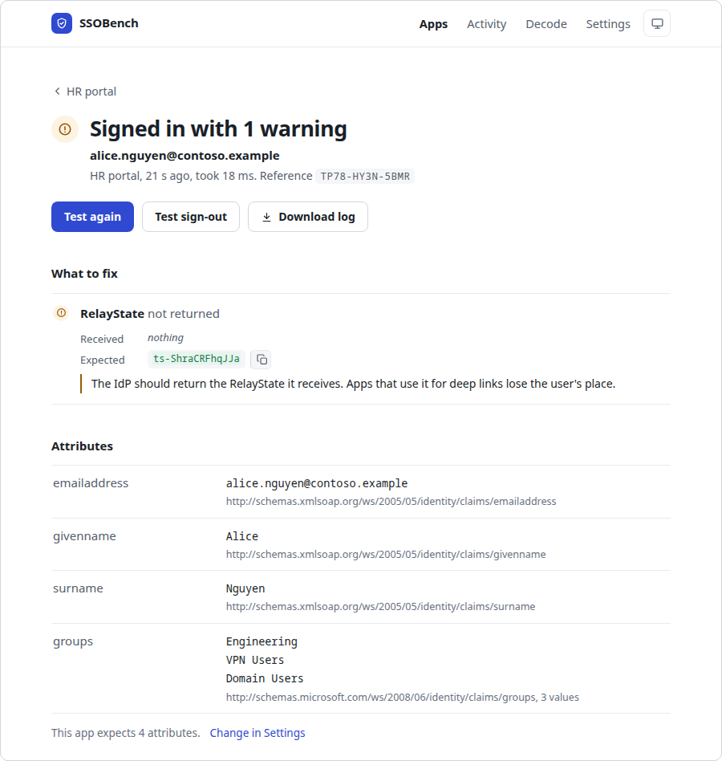

# SSOBench

[](https://github.com/ryanhebert/ssobench/releases/latest)
[](https://github.com/ryanhebert/ssobench/actions/workflows/ci.yml)
[](LICENSE)

**See exactly what your identity provider sends, and what is wrong with it.** Prove a new
integration works before the real application is ready, or show that a failure isn't the
application's fault.

When a single sign-on integration fails, the application usually says little more than "sign-in
failed". SSOBench takes the application's place. Register it at your identity provider like any SAML
or OpenID Connect app and sign in. It shows every attribute and claim that arrived, every check that
passed or failed, and how to fix each failure.

I've spent years on calls with people whose SSO rollout just broke, reading traces they'd never seen.
This is the tool I wanted to hand them.

<picture>
  <source media="(prefers-color-scheme: dark)" srcset="docs/images/result-dark.png">
  
</picture>

## What you can do with it

- Find out why a sign-in fails: the wrong audience or ACS URL, an expired or rotated certificate, a
  missing attribute, a clock out of sync, a weak or legacy algorithm (SHA-1, Triple DES, RSA PKCS#1
  v1.5), each flagged with the fix.
- Catch configuration drift: list the attributes an application needs, and every later sign-in that
  lacks one fails.
- Check an authorization server against OAuth 2.1 (an IETF draft): PKCE required, the implicit grant
  refused, the password grant refused for this client, and tokens for services through client
  credentials, checked against the resource you name.
- Test the user lifecycle: SCIM provisioning, roles, sessions and single logout.
- Give a test user a realistic sign-in page, and get a reference code back when it fails.
- Attach a step-by-step log of any attempt to a support ticket.

It supports SAML 2.0, OpenID Connect and OAuth 2.1, and runs as a single executable on Windows, macOS
or Linux. Hosted debuggers see your tokens; this runs on your machine, on `localhost` by default. A
decoder only reads messages; SSOBench validates signatures, provisions over SCIM, and keeps sessions
and roles.

## Quick start

1. Download the file for your system:

   | System | Download |
   |---|---|
   | Windows | [x64](https://github.com/ryanhebert/ssobench/releases/latest/download/ssobench-windows-amd64.exe), [Arm64](https://github.com/ryanhebert/ssobench/releases/latest/download/ssobench-windows-arm64.exe) |
   | macOS | [Apple silicon](https://github.com/ryanhebert/ssobench/releases/latest/download/ssobench-macos-arm64.tar.gz), [Intel](https://github.com/ryanhebert/ssobench/releases/latest/download/ssobench-macos-amd64.tar.gz) |
   | Linux | [x64](https://github.com/ryanhebert/ssobench/releases/latest/download/ssobench-linux-amd64.tar.gz), [Arm64](https://github.com/ryanhebert/ssobench/releases/latest/download/ssobench-linux-arm64.tar.gz) |

2. Run it.

   **Windows:** open the `.exe`. The binaries are not code-signed yet, so SmartScreen may ask you to
   choose **More info**, then **Run anyway**.

   **macOS:** in Terminal, in the folder you downloaded to. The second line clears the quarantine
   macOS puts on downloaded files, which would otherwise block an unsigned program.

   ```
   tar xzf ssobench-macos-*.tar.gz ssobench
   xattr -c ssobench
   ./ssobench
   ```

   If Safari already unpacked the download, skip the first line and run the other two inside the
   unpacked folder.

   **Linux:**

   ```
   tar xzf ssobench-linux-*.tar.gz ssobench && ./ssobench
   ```

   If port 8080 is busy, SSOBench uses the next free port and says which.

3. Your browser opens SSOBench. Choose **New app** and enter your identity provider's metadata URL
   (for SAML) or its issuer and your client ID (for OpenID Connect). Register the values from the
   app's **Set up** tab at your identity provider.

4. Choose **Test sign-in**.

The [guide](docs/guide.md) covers each protocol, user directories and SCIM, sessions, roles, HTTPS,
every option, and running SSOBench as a service. Checksums, software bills of materials and earlier
versions are on the [releases page](https://github.com/ryanhebert/ssobench/releases).

## Security

SSOBench shows tokens and assertions in full, because inspecting them is the point. Run it on your
own machine or a test server, and if other people can reach it, turn on console sign-in (a password
or passkeys) under **Settings**. The [guide](docs/guide.md#security) explains what is stored and
how. To report a vulnerability, see [SECURITY.md](SECURITY.md).

## Design decisions

- Two direct dependencies, both for XML signatures. Everything else is written on the standard
  library so each check can explain what it found, at the cost of verification code that has to be
  tested hard.
- Identity, attribute, audience and lifetime checks read only the assertion the signature covers.
  Envelope fields such as Destination and Status are checked as received, and unverified content is
  labeled.
- It plays the application. A mock identity provider is out of scope for now.

More in the [guide](docs/guide.md#design-decisions).

## How it's built

AI coding agents write the code, working from [AGENTS.md](AGENTS.md), which holds the rules they work
under. I design it, decide what each check tests and how it explains a failure,
[set the dependency limits and the tests](docs/guide.md#design-decisions), and test it with real
sign-ins. Every change runs against end-to-end tests with in-process SAML and OpenID Connect fakes,
and the JWT and passkey verifiers have Go fuzz targets that run weekly in CI. The first commit is a squash of earlier
agent-written work; nothing here was written by hand.

## Contributing

Bug reports and pull requests are welcome. See
[CONTRIBUTING.md](CONTRIBUTING.md) and the [roadmap](ROADMAP.md).

## License

Apache License 2.0. See [LICENSE](LICENSE). Third-party licenses are in
[THIRD_PARTY_NOTICES.txt](THIRD_PARTY_NOTICES.txt).
