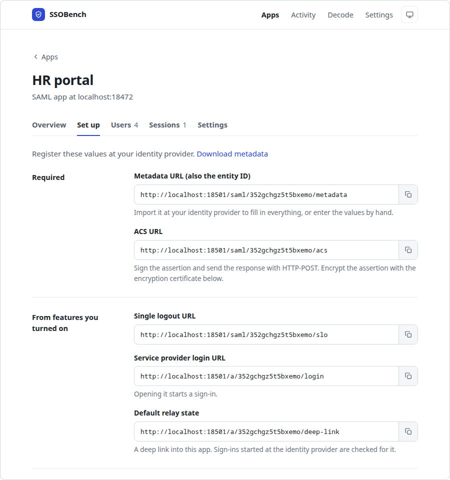
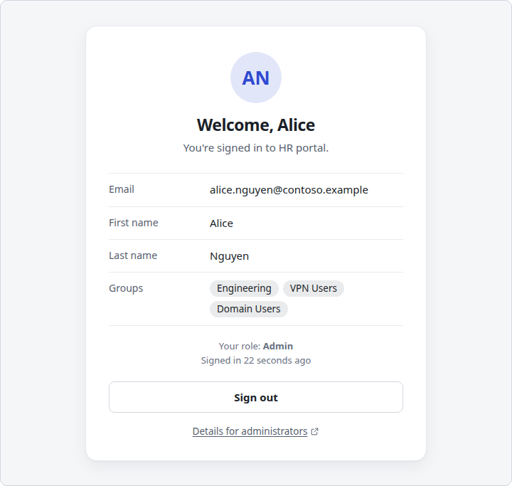

# SSOBench

[](https://github.com/ryanhebert/ssobench/releases/latest)
[](https://github.com/ryanhebert/ssobench/actions/workflows/ci.yml)
[](https://github.com/ryanhebert/ssobench/releases)
[](LICENSE)

SSOBench is a self-hosted tool for people setting up or debugging single sign-on. You register it at
your identity provider as an application, sign in, and it shows what the provider sent: the SAML
assertion or the OpenID Connect tokens, every attribute and claim, and a list of checks that passed
or failed, each with a suggested fix.

<picture>
  <source media="(prefers-color-scheme: dark)" srcset="docs/images/result-dark.png">
  
</picture>

- Works with SAML 2.0, OpenID Connect and OAuth 2.1 (an IETF draft).
- Checks signatures, audience, recipient, issuer, lifetimes and clock skew, replays, weak algorithms,
  certificate expiry, and signing certificates rotated since the metadata was loaded.
- Behaves like a real application, not just a decoder: each app gets a sign-in page, user accounts
  that SCIM can provision, roles, sessions and single logout.
- Logs every attempt step by step, ready to download and attach to a support ticket.
- Runs as one executable on Windows, macOS or Linux, with no database. It listens on `localhost` by
  default, so tokens from a real tenant stay on your machine.

## Quick start

Download the latest version for your computer:

| System | Download |
|---|---|
| Windows (x64) | [ssobench-windows-amd64.exe](https://github.com/ryanhebert/ssobench/releases/latest/download/ssobench-windows-amd64.exe) |
| Windows (Arm64) | [ssobench-windows-arm64.exe](https://github.com/ryanhebert/ssobench/releases/latest/download/ssobench-windows-arm64.exe) |
| macOS (Apple silicon) | [ssobench-macos-arm64.tar.gz](https://github.com/ryanhebert/ssobench/releases/latest/download/ssobench-macos-arm64.tar.gz) |
| macOS (Intel) | [ssobench-macos-amd64.tar.gz](https://github.com/ryanhebert/ssobench/releases/latest/download/ssobench-macos-amd64.tar.gz) |
| Linux (x64) | [ssobench-linux-amd64.tar.gz](https://github.com/ryanhebert/ssobench/releases/latest/download/ssobench-linux-amd64.tar.gz) |
| Linux (Arm64) | [ssobench-linux-arm64.tar.gz](https://github.com/ryanhebert/ssobench/releases/latest/download/ssobench-linux-arm64.tar.gz) |

Checksums, software bills of materials and earlier versions are on the
[releases page](https://github.com/ryanhebert/ssobench/releases).

**Windows:** run the downloaded `.exe`. The binaries are not code-signed yet, so SmartScreen may warn
the first time; choose **More info**, then **Run anyway**.

**macOS and Linux:** download, extract and run in one step (use the file name for your system):

```
curl -L https://github.com/ryanhebert/ssobench/releases/latest/download/ssobench-macos-arm64.tar.gz \
  | tar xz ssobench
./ssobench
```

If you downloaded the archive in a browser on macOS instead, clear the quarantine before running it:

```
xattr -d com.apple.quarantine ssobench
```

Your browser opens at `http://localhost:8080`. Choose **New app**, fill in your identity provider's
details and create it. The app's **Set up** tab then lists the values to register at the identity
provider.

<picture>
  <source media="(prefers-color-scheme: dark)" srcset="docs/images/setup-dark.png">
  
</picture>

## Connecting an app

Add one app in SSOBench for each application you configure at the identity provider. Each app has
its own SAML entity ID and Assertion Consumer Service (ACS) URL, or OpenID Connect redirect URI, so
several configurations can be tested side by side.

### SAML

1. Choose **New app**, keep **SAML**, and enter the identity provider's metadata URL, or paste its
   metadata XML.
2. At the identity provider, import the app's metadata URL, or enter the **Entity ID** and **ACS URL**
   from **Set up**. Set the identity provider to sign the assertion and to send the response by
   HTTP-POST.
3. Choose **Test sign-in**.

Sign-ins started at the identity provider, from an app tile or portal link, are checked the same
way. If a response is signed with a certificate the metadata does not list, SSOBench reloads the
metadata once and reports that the signing certificate was rotated.

### OpenID Connect

1. Choose **New app**, pick **OpenID Connect**, and enter the issuer URL, the client ID and, if the
   client has one, the client secret.
2. Register the **Redirect URI** shown under **Set up**.
3. Choose **Test sign-in**.

SSOBench runs the authorization code flow with PKCE, validates the ID token, decodes the access token
when it is a JWT, and calls the UserInfo endpoint.

### OAuth 2.1

For a client that gets access tokens for an API rather than signing people in:

1. Choose **New app**, pick **OAuth 2.1**, and enter the issuer URL, client ID and secret. You can
   also name the API, sent as the RFC 8707 `resource`, and the scopes to request.
2. Register the **Redirect URI** shown under **Set up**.
3. On the app's **Overview**, run any of these:
   - **Test sign-in** runs the authorization code flow with PKCE, then validates the access token
     the way an API would (signature, `typ`, issuer, audience, lifetime, scopes). It also asks the
     introspection endpoint about the token, tests refresh token rotation, and checks that the code
     cannot be redeemed twice.
   - **Machine token** uses the client credentials grant.
   - **OAuth 2.1 conformance** probes the server without signing in: PKCE must be required, and
     `plain` PKCE, the implicit and hybrid flows and the password grant must be refused. Redirect
     URIs must match exactly.
   - **Sign-in without PKCE** and **Wrong PKCE verifier** check that the server refuses both.

## Behaving like an application

### Sign-in page

Every app has a sign-in page at `/a/<app-id>` (the ID is in the app's URL), linked from the app as
**Open sign-in page**. It looks like an ordinary application: a **Sign in with single sign-on**
button, then a welcome screen with the person's name, email, groups and other attributes instead of
diagnostics. A failed sign-in shows a short reference code that matches the result under
**Activity**. Give the link to a test user, or register it as the app's login URL at the identity
provider.

<picture>
  <source media="(prefers-color-scheme: dark)" srcset="docs/images/welcome-dark.png">
  
</picture>

Sign-ins started at the identity provider land on the welcome screen too. To see the test result
instead, change where they land in the app's settings.

### User directory and SCIM

Turn on **User directory** in an app's settings and it keeps accounts the way an application does.
Each sign-in is matched to an account by NameID or `sub`, email, username, or any attribute or claim
you name.

- A sign-in with no matching account, or a deactivated one, fails. The person sees why, and the
  result shows what was compared. A near miss, such as the right name at a different email domain,
  is pointed out.
- With **Create an account at first sign-in** on, a missing account is created then (just in time).
- On the **Users** tab, accounts can be added by hand, imported from CSV
  (`userName,email,givenName,familyName,active`), deactivated and deleted.

An app with a directory is also a SCIM 2.0 target for Users and Groups. **Set up** shows the base URL
(`/scim/<app-id>/v2`) and a bearer token. Each request the identity provider makes is listed under
**Users › Provisioning** with its response, so you can provision a change and then sign in to see its
effect. Passwords sent by the identity provider are neither shown nor kept.

A cloud identity provider calls SCIM, and OpenID Connect back-channel logout, itself, so it has to
reach SSOBench. On a private network, publish only `/scim/` (and `/oidc/`, for back-channel logout)
through a reverse proxy, and enter the public SCIM address under **Address your identity provider
uses for SCIM** in the app's settings.

### Sessions

A sign-in through the sign-in page, or from the identity provider, starts a session tied to that
browser by a cookie. The app's **Sessions** tab lists active sessions, each with an **End** button,
and records how earlier ones ended:

- the person signed out;
- the identity provider sent a signed SAML logout request, matched by NameID and session index
  (unsigned requests are refused);
- an OpenID Connect back-channel logout arrived, verified and matched by `sid` or `sub`;
- the session lifetime or idle timeout passed, or the SAML `SessionNotOnOrAfter`;
- the account was deactivated or removed, by hand or by SCIM;
- an administrator ended it.

When the person comes back, the sign-in page tells them why their session ended.

### Access rules and roles

Under **Users › Access**, rules give a role, such as Admin or Viewer, when a sign-in carries a given
attribute or claim value, or when the person's account is in a group. The first matching rule
applies. Once rules exist, a sign-in that matches none is refused, and the result shows what each
rule checked. **Check the latest sign-in** runs the rules against the last sign-in, so you can adjust
them without signing in again.

## Checking what the identity provider does

### Expected attributes

List the attributes or claims an application needs under **Expected attributes** in the app's
settings, one per line, with `= value` to require a value. On a result, **Expect these at every
sign-in** saves the ones just received. Later sign-ins that lack one, or carry a different value,
fail.

### How the person authenticated

Each result shows the authentication method (the SAML authentication context, or `amr` and `acr`),
when it happened, and whether the identity provider reused an existing session. When ForceAuthn,
`prompt=login` or `max_age` was sent, the result says whether it was honored.

### SAML request options and encryption

A SAML app's settings choose what its requests ask for: a NameID format, an authentication context
(RequestedAuthnContext, compared as exact, minimum, better or maximum), ForceAuthn and IsPassive.
The result reports what the identity provider did with each.

With **Expect encrypted assertions** on, SSOBench publishes an encryption certificate in its metadata
and under **Set up**. It decrypts AES-GCM, AES-CBC and Triple DES content with RSA-OAEP or RSA
PKCS#1 v1.5 key transport, names the algorithms on the result, flags the weak ones, and fails an
assertion that arrives unencrypted.

### OpenID Connect request options

`acr_values` and `login_hint` are sent with each sign-in and checked against the ID token. Each
result lists the scopes requested, whether each was granted, and which of its claims arrived in the
ID token or from UserInfo.

## HTTPS

Most identity providers accept `http://localhost` redirect URIs. If yours requires HTTPS:

```
ssobench -tls                                  # self-signed certificate, kept beside the state file
ssobench -cert server.pem -key server-key.pem  # your own certificate
```

A certificate renewed in place, for example by an ACME client, is picked up within a minute.

The URLs SSOBench gives the identity provider follow the address you opened it at, so
`https://sso-test.example.com:8443` and `https://localhost:8443` each show their own values. Register
the address you will use; if a sign-in starts at another one, the result says so. The `-tls`
certificate covers this machine's host names and IP addresses.

Behind a reverse proxy, pin the public URL:

```
ssobench -listen 127.0.0.1:8080 -base-url https://sso-test.example.com
```

## Decoding without signing in

```
ssobench decode eyJhbGciOi...              # a JWT
ssobench decode saml-response.txt          # a base64 SAMLResponse from a browser trace
pbpaste | ssobench decode -                # from standard input (macOS; xclip -o on Linux)
```

The **Decode** page does the same in the browser. Decoding does not verify signatures, since there is
no key to check them against.

## Options

| Flag | What it does |
|---|---|
| `-port` | Port to listen on. Default: `8080` |
| `-listen` | Address to listen on. Default: `127.0.0.1:<port>` |
| `-base-url` | Public URL to put in the registered URLs, for a reverse proxy. Without it, they follow the address in the browser |
| `-tls` | Serve HTTPS with a generated self-signed certificate |
| `-cert`, `-key` | Serve HTTPS with your own certificate |
| `-skew` | Allowed clock skew when checking lifetimes. Default: `2m` |
| `-no-open` | Do not open a browser on start |
| `-allow-host` | Another host name SSOBench answers to, such as a DNS alias; repeatable |
| `-state` | File that keeps apps and user directories across restarts; results and the log go in a history file beside it. `off` keeps nothing. Default: `ssobench/state.json` in the user config folder |
| `-admin-password-file` | File holding a console password, in addition to any set under **Settings** |
| `-reset-console-sign-in` | Remove the console password and passkeys saved under **Settings** |

## Running as a service

SSOBench is a plain executable, so any service manager can run it.

On Linux with systemd:

```ini
[Unit]
Description=SSOBench

[Service]
ExecStart=/usr/local/bin/ssobench -no-open -listen 127.0.0.1:8080 \
    -state /var/lib/ssobench/state.json
StateDirectory=ssobench
DynamicUser=yes
Restart=on-failure

[Install]
WantedBy=multi-user.target
```

On Windows, use a service wrapper such as [WinSW](https://github.com/winsw/winsw) or
[NSSM](https://nssm.cc), or a Task Scheduler task that runs at startup, with the arguments
`-no-open -listen 127.0.0.1:8080`.

## Security

SSOBench shows tokens and assertions in full, because inspecting them is the point. Run it on your
own machine or a test server, and register it at the identity provider as a test application, not
in place of a production one.

- Console sign-in: the console (apps, settings, results and activity) is open to anyone who can
  reach SSOBench until you turn on sign-in under **Settings**, with a password, passkeys or both.
  Sign-in pages, identity provider endpoints and SCIM stay open, because test users and the identity
  provider need them. SSOBench prints a warning when it listens on a network address with no console
  sign-in.
  - The password is stored as a PBKDF2-SHA256 hash, and passkeys as public keys.
  - Passkeys need a host name rather than an IP address, and HTTPS except on `localhost`. A passkey
    works only at the host name it was added at.
  - For unattended setups, a password can also be given at start with `-admin-password-file` or the
    `SSOBENCH_ADMIN_PASSWORD` environment variable.
  - If you are locked out, start SSOBench once with `-reset-console-sign-in`.
- Host names: SSOBench answers only to IP addresses, `localhost`, this machine's names, the
  `-base-url` host and names given with `-allow-host`. A web page elsewhere therefore cannot reach it
  through a DNS name it controls (DNS rebinding).
- Saved files: the state file holds apps and user directories, and the history file beside it holds
  full sign-in results and the log. On Linux and macOS both are readable only by the account running
  SSOBench. On Windows they take the permissions of their folder; the default, in the user profile,
  is private to that account.
- Client secrets are kept in memory, unless **Keep it across restarts** is checked under the app's
  client secret, in which case the secret is saved in the state file too. A client secret is never
  shown on a page or written to the log.
- SCIM tokens are shown on the app page to anyone who can open the console.
- The log shortens every token.
- Each SAML app gets its own signing key at first use, kept in the state file. SSOBench signs logout
  messages with it, and sign-in requests when **Sign sign-in requests** is on. Apps that expect
  encrypted assertions also get an encryption key. Both certificates are in the app's metadata and
  under **Set up**.

To report a vulnerability, see [SECURITY.md](SECURITY.md).

## Building from source

With Go 1.25 or later (the `go` command fetches the toolchain version pinned in `go.mod`):

```
go build -trimpath -ldflags "-s -w" .
go test ./...
```

Besides the Go standard library, SSOBench uses two libraries:
[goxmldsig](https://github.com/russellhaering/goxmldsig) for XML signature verification, and
[etree](https://github.com/beevik/etree) for XML. The OpenID Connect, OAuth, SCIM and passkey code is
written on the standard library, so each check can explain exactly what it found. Their licenses are
in [THIRD_PARTY_NOTICES.txt](THIRD_PARTY_NOTICES.txt), which ships in every release archive. CI and
the release build run `govulncheck`.

[ROADMAP.md](ROADMAP.md) lists what is done and what is planned. To contribute, see
[CONTRIBUTING.md](CONTRIBUTING.md).

## License

Apache License 2.0. See [LICENSE](LICENSE).
